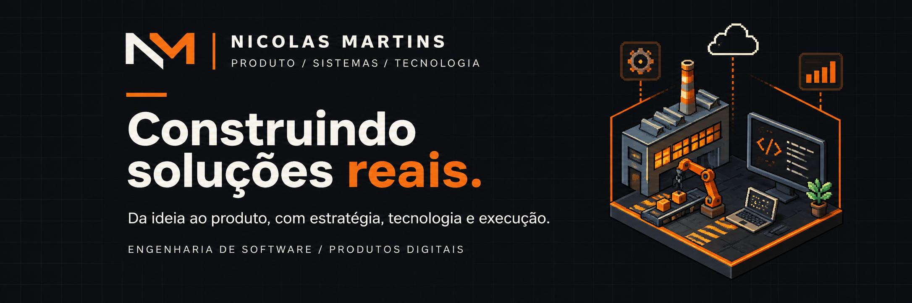

 

**Analista de Produto · Engenharia de Software · Desenvolvimento de Sistemas**

Rio Grande do Sul, Brasil · Português nativo · Inglês avançado

---

## 01 / Sobre mim

Minha trajetória começou na indústria, atuando como eletromecânico em manutenção industrial. Hoje trabalho com análise de produto e sistemas, conectando necessidades de negócio, requisitos e tecnologia.

Estudo Engenharia de Software e desenvolvo projetos autorais para explorar soluções que vão da automação de processos à construção de aplicações web e integrações.

> Acredito que tecnologia tem valor quando resolve um problema real.

## 02 / Áreas de atuação

| Produto | Sistemas | Desenvolvimento |
| :--- | :--- | :--- |
| Análise de requisitos | Integrações e APIs | Backend Java e Spring Boot |
| User stories e critérios de aceitação | Processos e automação | React, Angular e TypeScript |
| Prototipação e homologação | Análise de regras de negócio | SQL, testes e versionamento |

## 03 / Tecnologias

**Backend e dados**

**Frontend**

**Ferramentas e práticas**

## 04 / Projetos selecionados

| Projeto | Proposta | Tecnologias |
| :--- | :--- | :--- |
| [JobTracker](https://github.com/Nmartins6/job-tracker) | Organização de candidaturas e acompanhamento de oportunidades. | Java, Spring Boot, Angular, JPA |
| [Card Transactions Service](https://github.com/Nmartins6/card-transactions-service) | Simulação de autorização de transações e rastreabilidade. | Java, Spring Boot, PostgreSQL, MongoDB |
| [Gerenciador de Ordens Datasul](https://github.com/Nmartins6/ordens-datasul) | Automação de relatórios industriais para planilhas Excel. | Java, Spring Boot, Apache POI |
| [MagicFridgeAI](https://github.com/Nmartins6/MagicFridgeAI) | Geração de receitas com IA e integração de APIs. | Java, Spring Boot, WebFlux |
| [Casa Nacoli Special Dates](https://github.com/Nmartins6/casa-nacoli-special-dates) | Experiência web responsiva. [Demo](https://casa-nacoli-special-dates.vercel.app) | Astro, Vercel |

## 05 / Em evolução

Arquitetura de software, inteligência artificial aplicada, integrações, produtos digitais, automação e desenvolvimento de sistemas.

PRODUTO / SISTEMAS / TECNOLOGIA — DA IDEIA À EXECUÇÃO

